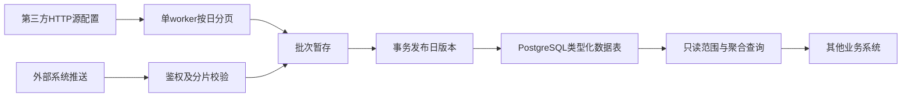

# 架构说明

> 历史说明：本文引用的 evidence 文件、截图和日志仅本机保管，不随 Git 仓库分发；历史测试结果不代表本次或云端验证。

版本1.5.0。一个Docker Compose项目包含PostgreSQL17、FastAPI API、独立worker和一次性init。两个常驻Python进程复用同一业务镜像；无Node、Vue、看板、Redis或消息中间件。此前看板服务不属于本项目依赖。

## 数据流

## 存储与原子性

datasets保存字段/日期/主键/保留策略的不可变元数据。每个数据集创建独立records_UUID物理表，用户字段使用PostgreSQL类型，内部维护_batch_id、_date、_key。UUID表名由服务生成，字段和聚合操作均使用白名单和安全SQL标识符，不把用户字符串当SQL执行。

batches记录push/pull任务和状态；batch_chunks记录分片摘要，保证重传幂等；published_days保存数据集+日期的当前成功批次。数据只从已发布版本读取。完成校验后，在一笔事务中更新发布指针、记录成功和清除旧事实；并发读取看到旧版或新版，不会看到半天数据。

同数据集同日只能有一个待处理/上传/运行批次。分片事务锁定批次行，重复主键分片回滚；分片序号重传必须内容一致。推送必须声明预期行数，发布时检查行数及分片从0连续。整日替换的0行批次可发布空日；按主键更新的0行输入保留该日旧行，不代表源中所有旧键已被删除。拉取必须看到空页才结束，短页不能证明已完整。

字段结构变化不会自动ALTER已有表，重复注册相同定义幂等、不同定义409。当前数据库模式版本5，显式init；高版本库拒绝低版本程序初始化。不存在绕过类型校验的通用SQL接口。

## 查询

字段选择、筛选、分组、聚合、排序全部在数据库内执行。日期及批次有索引，业务主键按规范化值散列形成固定长度内部键。当前不预生成所有日期区间，也不预存每个分组组合；范围查询基于类型化日事实动态聚合，因此实际性能与事实数量、维度基数和筛选有关。

每个单查询或跨数据集批量采用REPEATABLE READ READ ONLY事务。其意义是同一批量内多个SQL使用一致视图；并不阻止发布事务提交，也不保证两次独立HTTP分页请求永远同版。PostgreSQL官方说明见[事务隔离](https://www.postgresql.org/docs/17/transaction-iso.html)和[显式锁](https://www.postgresql.org/docs/17/explicit-locking.html)。

单条SQL默认15秒超时、锁等待5秒；单请求体2MiB、单分片1000行、单批次100万行、单结果500行、批量10项、最多180天、最多20筛选及每个in200值。命名服务器游标逐行读取，单查询JSON响应最多8MiB，批量总JSON响应最多16MiB；追加每行前计量，超限413，不能先将所有行加载后再判断。这是响应正文预算，不是Python进程RSS硬上限。15秒是单条SQL时限，不是整个批量HTTP请求的总耗时保证。

## 身份与边界

管理员使用scrypt密码哈希和数据库可撤销短期会话；机器密钥随机生成、只返回一次、数据库仅存SHA256，按数据集read/write授权，有到期、撤销和每分钟限频。write只能上传自己拥有的批次，不能建表、改源或创建密钥。API路由已在OpenAPI声明两种身份，参考[FastAPI安全机制](https://fastapi.tiangolo.com/tutorial/security/)。

源URL通过部署配置或管理员页面设置，部署白名单或管理员显式批准主机；禁止重定向及URL内凭据。文件来源密钥通过环境变量引用，页面来源凭据加密持久化。日志不打印DSN、请求体、响应原文或Authorization。匿名仅健康检查和接口结构说明。服务默认只绑定本机；远程开放需部署方配置TLS及网络边界。

## worker与故障

worker持数据库会话级独占锁；另一个worker不能抢占。重启取得锁后将上次running标记失败并清暂存，成功指针保留；pending继续处理。每源客户端跨日期复用限频状态，一个日期失败记录错误后继续其他任务。页面来源在任务间刷新，无需重启；写入方式在入队时冻结，来源请求参数在开始执行时读取并用于整次任务。

每天按北京时间执行保留清理，各数据集事务独立。未完成上传24小时失效；保留窗外已结束批次清理。调度默认关闭，文件来源可配置北京时间小时，页面来源可配置多个HH:mm时点与回刷天数；日终数据源尚在更新时不得把分页结果宣称为源一致快照。

部署只提供单机可用性。备份文件需要由运维异地存储，异地备份/投递告警/高可用并未内置。真实容量、服务器最低规格和完整180天性能必须以实际字段宽度和维度基数压测，不从少量合成数据推断。

## 管理控制平面（数据库版本2）

同一个FastAPI进程以 `/admin/` 提供离线HTML/CSS/ES模块，通过Bearer会话调用管理API；外部系统用X-API-Key调用数据API。新增 `managed_sources`（来源协议/映射/每源调度/修订/加密凭据）和 `query_services`（固定查询模板/动态筛选白名单/分页上限/开放状态/修订）两表。迁移采用全局事务锁和单事务版本记录，仅增表，不改变既有记录表及发布指针。

来源凭据使用cryptography.Fernet，解密密钥来自环境，管理源不能读取任意进程环境秘密。worker每个任务间重载来源，未修改客户端复用限频状态；每分钟检查日调度，原幂等键防止重复。单日执行使用同一来源版本。查询服务调用复用QueryRequest和现有参数化SQL引擎，在同一只读快照中读取规则和已发布数据。无自由脚本、任意SQL或第二套金额计算。

管理页面新增表单并未扩大机器权限：机器不能注册表、改来源或改加工规则；旧policy=NULL的read仍是逐表整表读取授权；1.5.0受限密钥显式限制接口及行范围，通用表read仍不提供列级权限。`revision`比较防止陈旧页面覆盖他人修改。依赖cryptography48.0.1来自PyPI，认证加密选型参考官方Fernet文档 https://cryptography.io/en/latest/fernet/ ，版本及许可证记录于evidence/dependencies.json。

## 1.1.2 多时点与合并发布

schema3在managed_sources增加schedule_times、write_mode，batches增加write_mode、published_row_count。旧数据迁移为原小时对应的单时间、replace_day，保持原调用行为。SourceSave把输入校验和排序集中处理，worker读规范化后的来源配置。每个时点+业务日独立幂等；同日期已有活动任务时等待，仍保持单worker排他和每分钟检查。

upsert复用现有版本化存储：本次返回先写独立暂存批次；发布事务在持有批次与当前发布行锁时，用参数化INSERT SELECT复制旧版本中本次未出现的_key。当前暂存行优先，NULL不回退旧值。复制最多剩余发布容量+1行以判断超限，超限事务回滚。随后一次切换published_days，写入published_row_count并删除旧版本；查询仍只读发布批次。批次row_count始终表示接收数，避免把保留行伪装为从来源拉取的新行。未改变金额计算、字段校验或跨日唯一性范围。

## 1.2.0聚合后公式与结果筛选

直接查询、批量、预览和已保存接口共用QueryRequest及查询编译器。SQL先完成已发布版本范围筛选和分组，在外层对数字聚合别名计算受限公式并ROUND；再外层执行结果筛选。计数和排序分页均建立在最终结果上。公式解析只接受白名单算术节点，标识符经验证和引用，常量作为Decimal参数绑定，不使用eval/exec或拼接用户SQL。公式内部编译成精确分子/分母，最终通过NUMERIC整除与余数一次完成指定小数位的舍入，不使用中间有限小数商；每处原始除法保留NULLIF零保护，不能约掉造成未定义的零因子。完整展开限制2048计算节点，含舍入重复引用，防止嵌套除法造成SQL无限增长。

无新的数据库表、存储字段或计算服务。新增规则存入现有query_services.definition；缺失新列表时按空列表处理。仍受SQL超时、日期窗、聚合/公式数量、输出大小、权限和只读事务限制。历史明细查询路径保留。

## 1.3.0 可审核的配置助手

新增`llm_config`负责配置验证、Fernet密钥加密、revision及请求互斥；`llm_client`负责有界HTTP调用；`query_drafts`只提供当前表元数据、验证草稿；`llm_routes`维持管理员认证边界。前端`formula-builder.js`和`query-assistant.js`辅助既有加工表单，`llm.js`管理连接配置，不另建查询引擎。

schema4只新增单行`llm_settings`配置表，迁移和版本记录在同一事务执行。真实业务表、已发布版本、来源配置及原加工服务不变。加密使用现有`DS_CONFIG_ENCRYPTION_KEY`，数据库不存明文KEY；连接测试不写数据库。管理员换目标origin时必须重填或清除KEY，避免旧密钥被静默转发。

HTTP边界：OpenAI兼容非流式Chat Completions、无重定向、禁用环境代理、TLS正常验证、总超时5～90秒（含DNS和读取）、请求/响应各256KiB上限、无计费请求自动重试。允许管理员明确配置的内网地址；拒绝云元数据、link-local、未指定和多播等特殊地址，并检查DNS结果。全服务数据库级互斥控制模型请求，不影响原手工配置或正常查询。

模型输出不是执行计划权限：严格JSON解码禁止重复键与非有限数值；Pydantic禁止额外字段；复用QueryServiceSave和现有查询编译校验验证字段、类型、公式、筛选、排序、规模。之后只返回可审阅草稿，用户应用到表单后再走既有预览/保存路径。原聚合精度、空值、排序、分页、机器授权语义完全沿用。

当前不提供RAG、自动查数、自动SQL、跨表JOIN或智能体工具调用；不持久化需求对话。新增可变依赖仅为管理员自行配置的模型服务，没有新增Python第三方包。

## 1.5.0 查询权限

api_keys.policy存放可空的声明式权限，NULL保持旧行为。受限密钥的通用表授权与接口授权分别检查；接口授权绑定数据表，防止换表后扩大权限。每个授权表必须显式设定全部或限定范围。条件只允许合法文本维度的精确值，组内AND、组间OR；SQL标识符安全引用、值参数绑定。范围在原始记录WHERE层注入，不受请求体覆盖，COUNT、公式及排序共用同一结果。受限范围下发布元数据额外按授权条件分日计数。写入权限不与受限读策略混用。无新增中间件或核心依赖。
